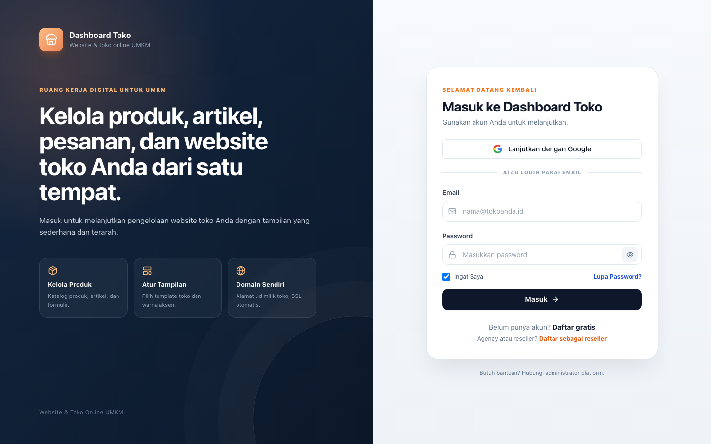
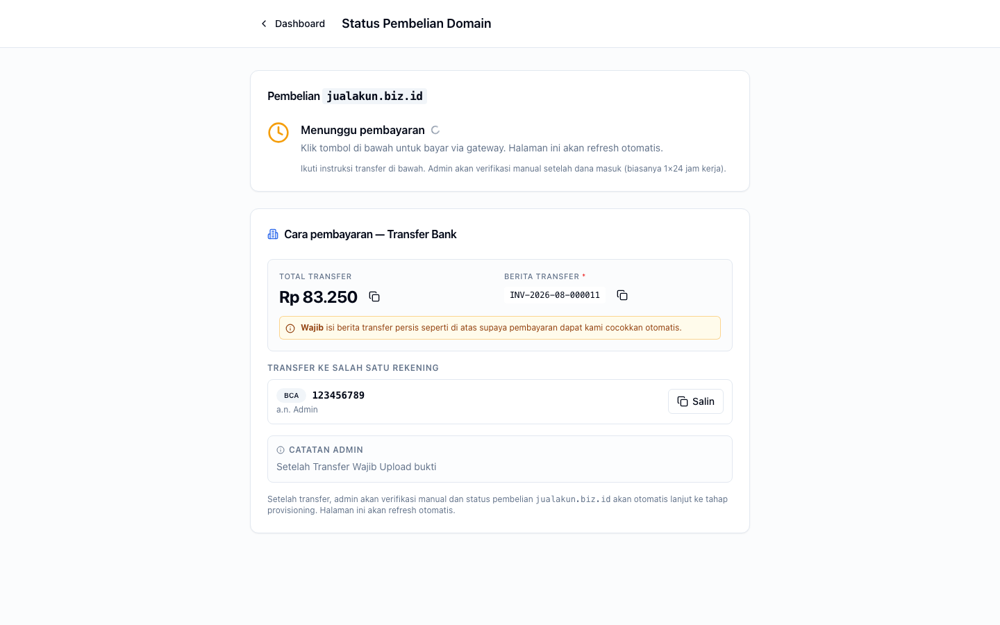
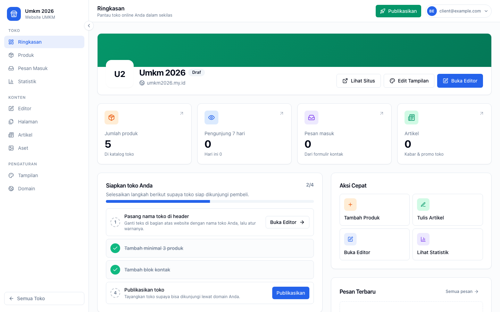
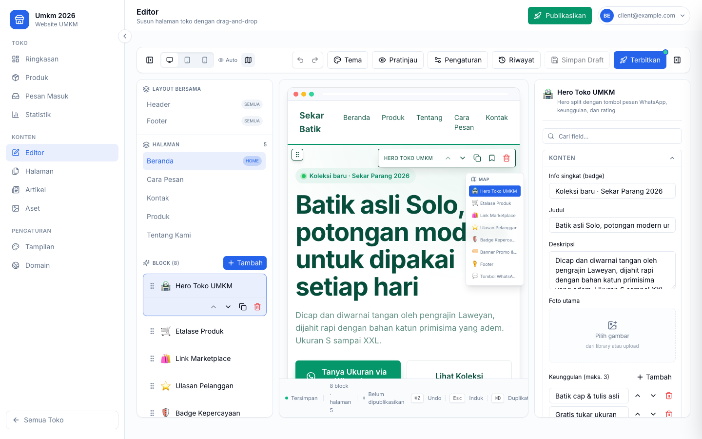
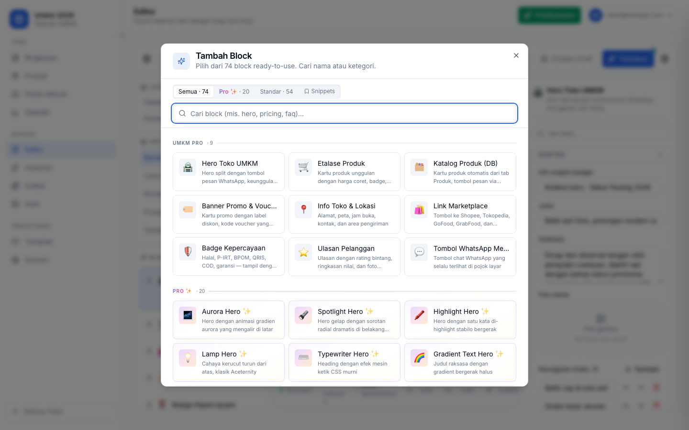
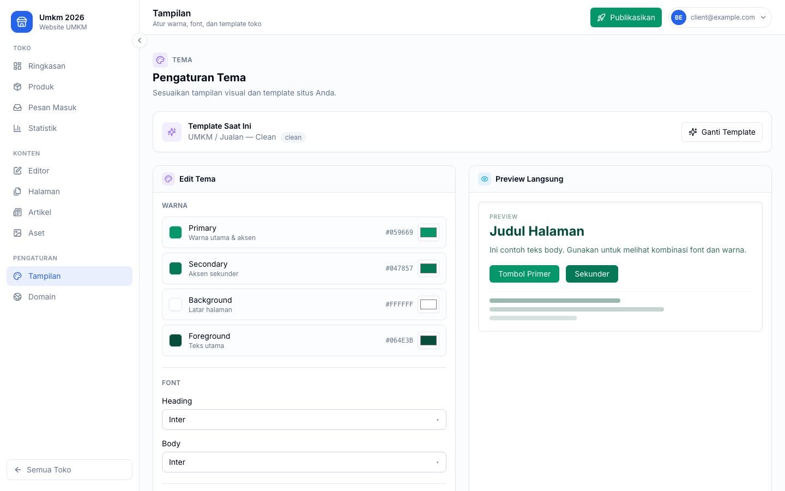
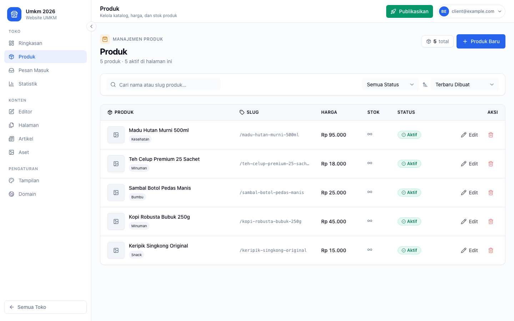
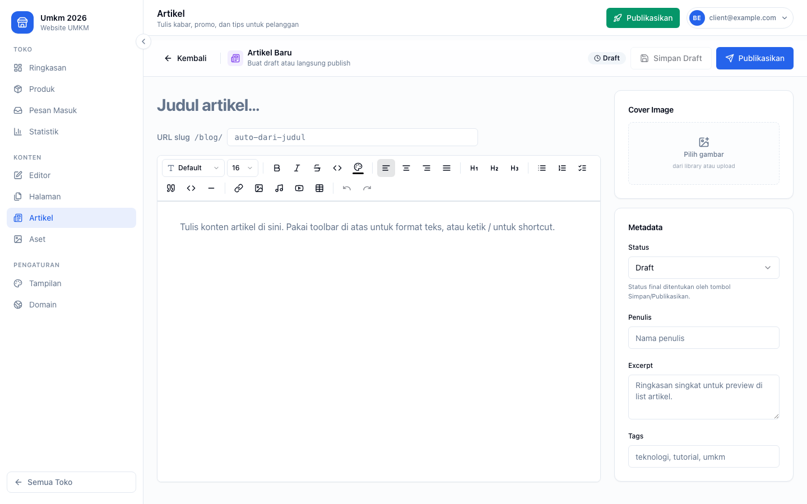
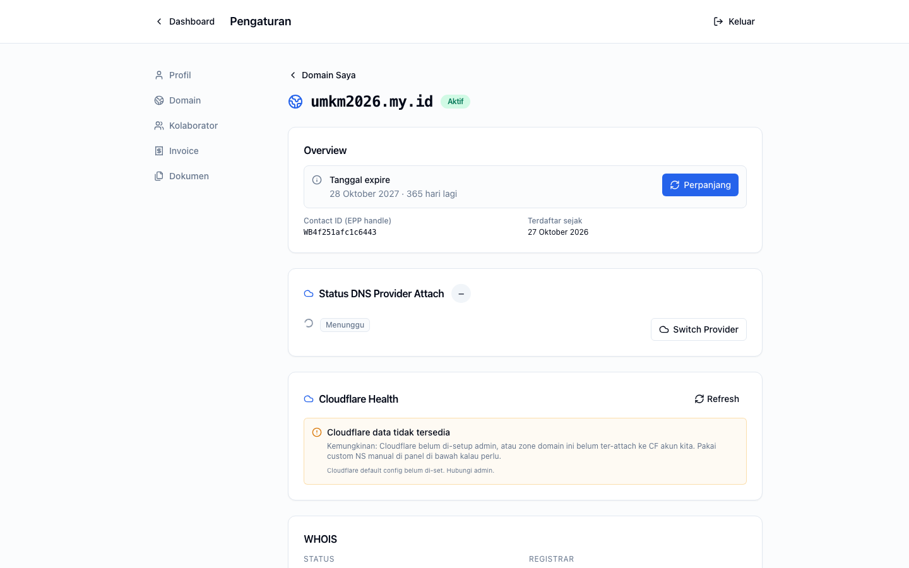

# Bab 1 — Panduan Client (Pengguna Umum)

Untuk pemilik usaha (UMKM) yang mau punya toko online sendiri di domain `.id`.
Semua flow di sini bisa dilakukan sendiri tanpa bantuan Agent/Reseller.

## Overview Flow

```
┌──────────────┐    ┌───────────────┐    ┌───────────────┐
│  Registrasi  │───►│ Beli Domain   │───►│ Pilih Template│
│  + Verify    │    │ + Bayar       │    │ + Bikin Situs │
│    Email     │    │               │    │               │
└──────────────┘    └───────────────┘    └───────┬───────┘
                                                 │
                                                 ▼
┌──────────────┐    ┌───────────────┐    ┌───────────────┐
│  Situs Live  │◄───│ Publikasikan  │◄───│ Edit Block    │
│  di domain   │    │   Situs       │    │  di Editor    │
└──────────────┘    └───────────────┘    └───────────────┘
```

## 1.1 Registrasi & Login

### Registrasi

1. Buka `https://kubaca.id/register`
2. Isi:
   - **Nama lengkap**
   - **Email** — akan jadi username login
   - **Password** — min 8 karakter
3. Klik **Daftar** → cek email untuk **link verifikasi**
4. Klik link verifikasi → account aktif, siap login

Kalau tidak menerima email dalam 5 menit:
- Cek folder Spam
- Klik "Kirim ulang" di halaman login
- Kalau tetap tidak masuk, hubungi support

### Login



1. `https://kubaca.id/login`
2. Email + password
3. Kalau lupa password → klik "Lupa Password" → email reset

## 1.2 Lengkapi Profil

**Wajib diisi sebelum beli domain**, karena data ini dipakai untuk WHOIS
contact:

1. Klik nama Anda di kanan atas → **Profil**
2. Isi:
   - **Nama** (sudah dari registrasi)
   - **Nomor telepon** — format `+6281234567890`
   - **Alamat lengkap**
   - **Kota**
   - **Provinsi**
   - **Kode pos**
   - **NIK** (opsional, tapi **WAJIB untuk domain `.id`** karena regulasi PANDI)

Kalau salah satu field kosong, wizard beli domain akan tampilkan peringatan
"Profil belum lengkap, kurang: nama, phone, ...".

## 1.3 Beli Domain + Buat Situs

Flow ini gabungkan "daftar domain" + "buat situs" dalam satu wizard.

### Langkah 1 — Cari Domain


1. Klik **"Beli Domain + Buat Situs"** di dashboard
2. Ketik nama domain:
   - Format singkat: `myshop` → sistem tampilkan hasil per TLD (`myshop.id`, `myshop.co.id`, `myshop.com`, dsb.)
   - Format lengkap: `myshop.co.id` → cek 1 domain spesifik
3. Klik **Cek Ketersediaan**
4. Hasil muncul:
   - ✅ **Tersedia** — hijau, klik untuk pilih
   - ❌ **Sudah dipakai** — abu, tidak bisa dipilih

Setiap domain tersedia menampilkan **harga** (register + renew) sesuai role
Anda. Untuk client, ini adalah harga retail.

### Langkah 2 — Konfirmasi Pembelian

Setelah pilih domain:

1. **Cek profil** — kalau ada field kurang, klik "Lengkapi" untuk isi
2. **Upload dokumen** (kalau domain `.id`) — KTP atau NPWP
3. **Lama registrasi** — pilih 1, 2, 3, 5, atau 10 tahun (semakin lama biasanya diskon per tahun)
4. **Metode pembayaran** — pilih dari yang tersedia:
   - **Midtrans / Paylabs** — kartu kredit, virtual account, e-wallet
   - **Transfer Bank Manual** — transfer + kirim bukti (admin verify manual)
5. **Kode Promo** (opsional) — masukkan code lalu klik **Terapkan** untuk lihat diskon
6. **Total** — tampilkan breakdown: harga × tahun − promo = **Total bayar**
7. Klik **Beli & Bayar**

### Langkah 3 — Bayar



Berdasarkan metode:

**Gateway (Midtrans/Paylabs):**
- Redirect ke halaman gateway → bayar via VA/kartu/e-wallet
- Setelah bayar, halaman kembali ke `/sites/pending/<jobId>` otomatis

**Manual Bank:**
- Halaman `/sites/pending/<jobId>` menampilkan instruksi:
  - Total transfer
  - Berita transfer (nomor invoice — **WAJIB** dicantumkan di transfer)
  - Daftar rekening tujuan
- Transfer sesuai instruksi
- Tunggu admin verify (~1×24 jam kerja)

### Langkah 4 — Tunggu Provisioning

Halaman `/sites/pending/<jobId>` auto-refresh 3-5 detik.

Status yang mungkin muncul:
- **Menunggu pembayaran** — belum bayar
- **Sedang diproses registrar** — payment OK, EPP register sedang jalan (~1-5 menit)
- **Domain aktif** — sukses, siap pilih template
- **Gagal** — cek pesan detail, tombol **Coba Lagi** tersedia (tidak charge ulang)

### Langkah 5 — Pilih Template


Setelah status **aktif**:

1. Muncul list template toko UMKM, masing-masing dengan contoh usaha berbeda:
   - **Modern** — kedai kopi (contoh: Kopi Senja)
   - **Clean** — fashion/batik (contoh: Sekar Batik)
   - **Professional** — kerajinan (contoh: Anyam Lestari)
2. Semua template sudah berisi blok UMKM Pro (hero toko, etalase produk, promo,
   ulasan, info toko, tombol WhatsApp) — tinggal ganti isinya
3. Klik **Preview** untuk lihat live di iframe modal
4. Klik card template → panel bawah muncul:
   - **Nama situs** (default dari nama domain, bisa diedit)
5. Klik **Buat Situs** → sistem create site + attach ke domain → redirect ke editor

### Dashboard Toko



Setiap situs punya dashboard sendiri dengan menu di sidebar:

| Grup | Menu | Fungsi |
|---|---|---|
| Toko | **Ringkasan** | Statistik singkat + checklist persiapan toko |
| Toko | **Produk** | Kelola katalog produk (§1.7) |
| Toko | **Pesan Masuk** | Kiriman formulir dari pengunjung (§1.9) |
| Toko | **Statistik** | Jumlah pengunjung per hari |
| Konten | **Editor** | Susun blok halaman (§1.4) |
| Konten | **Halaman** | Daftar halaman situs (§1.5) |
| Konten | **Artikel** | Blog toko — kabar, promo, tips (§1.8) |
| Konten | **Aset** | Gambar & berkas (§1.10) |
| Pengaturan | **Tampilan** | Warna, font, ganti template (§1.6) |
| Pengaturan | **Domain** | Kelola domain (§1.13) |

Halaman **Ringkasan** menampilkan jumlah produk, pengunjung 7 hari terakhir,
pesan masuk, dan artikel, plus **checklist persiapan toko**:

1. Pasang nama toko di header (ganti nama contoh dari template)
2. Tambah minimal 3 produk
3. Tambah blok kontak / WhatsApp
4. Publikasikan toko

Setiap item checklist bisa diklik untuk langsung ke halaman terkait.

## 1.4 Editor — Susun Halaman



### Layout Editor

Tampilan editor terbagi 3 kolom (desktop):

```
┌─────────────┬─────────────────────────┬─────────────┐
│  Sidebar    │  Canvas (preview live)  │  Panel      │
│  block tree │                         │  properties │
│             │                         │  + layout   │
│  ─────────  │                         │  ─────────  │
│  [ Hero  ]  │      < Live Preview >   │  Content    │
│  [ Feat  ]  │                         │  Layout     │
│  [ CTA   ]  │                         │  Style      │
│  [ Blog  ]  │                         │             │
└─────────────┴─────────────────────────┴─────────────┘
    Left panel      Center canvas          Right panel
   (drag reorder)   (klik block select)   (edit props)
```

- **Sidebar kiri**: daftar block yang ada di halaman (tree hierarchy)
- **Canvas tengah**: rendering live seperti pengunjung situs
- **Panel kanan**: edit properti block yang di-select

### Tambah Block Baru

1. Klik tombol **+** di canvas (muncul saat hover antar block)
2. Pilih block dari galeri:
   - **UMKM Pro**: blok khusus toko (lihat di bawah)
   - **Layout**: Container, Columns, Divider, Spacer
   - **Content**: Heading, Text, Image, Button
   - **Hero**: AuroraHero, HighlightHero, LampHero, SpotlightHero
   - **Feature**: HoverGlowGrid, IconGrid, MovingBorderCTA
   - **Data-driven**: ProductGrid, BlogList, FormBlock
3. Block baru ditambahkan ke posisi

### Blok UMKM Pro



Blok siap pakai untuk toko online. Semua otomatis mengikuti warna & font tema.

| Blok | Kegunaan |
|---|---|
| **Hero Toko UMKM** | Bagian pembuka: judul, jam buka, tombol "Pesan via WhatsApp", foto produk, rating |
| **Etalase Produk** | Produk unggulan dengan harga coret + diskon otomatis, badge Terlaris/Baru/Promo, tombol pesan per produk |
| **Katalog Produk (DB)** | Sama seperti Etalase, tapi produk diambil otomatis dari menu **Produk** |
| **Banner Promo & Voucher** | Promo dengan kode voucher (pengunjung bisa salin kode) + masa berlaku |
| **Info Toko & Lokasi** | Alamat, jam buka per hari, kontak, area antar, peta Google Maps |
| **Link Marketplace** | Tombol ke toko Anda di Shopee, Tokopedia, TikTok Shop, GoFood, dsb. |
| **Badge Kepercayaan** | Halal, PIRT, BPOM, QRIS, COD, garansi, dsb. |
| **Ulasan Pelanggan** | Ulasan dengan bintang 1–5 + rata-rata rating |
| **Tombol WhatsApp Melayang** | Tombol WhatsApp yang selalu terlihat di pojok layar |

**Nomor WhatsApp**: isi dengan format biasa (mis. `0812-3456-7890`) — sistem
otomatis mengubahnya ke format `wa.me` internasional. Template memakai nomor
contoh `081234567890`, **ganti dengan nomor toko Anda** sebelum publish.

### Edit Block Content

1. Klik block di canvas atau sidebar → panel kanan muncul
2. Tab **Properti**: edit isi (title, subtitle, ctaLabel, imageUrl, dsb.)
3. Tab **Layout & Style**:
   - **Padding & margin** — 4 sisi + responsive per device (desktop/tablet/mobile)
   - **Alignment** — kiri/tengah/kanan
   - **Max width** — full / narrow / prose / wide
   - **Background color** — pilih warna override
   - **Theme override** — override primary/secondary/bg/fg khusus block ini
   - **Hidden on device** — sembunyikan block di mobile/tablet

### Drag & Drop untuk Reorder

- Tarik block di sidebar tree → drop ke posisi baru
- Support nesting: masukkan block ke dalam Container/Columns

### Duplicate / Delete Block

- Klik block → tombol icon di toolbar block:
  - **Copy** — duplicate block persis
  - **Trash** — hapus block

### Undo / Redo

- **Ctrl+Z** / **⌘+Z** — undo perubahan terakhir
- **Ctrl+Shift+Z** — redo

## 1.5 Halaman (Pages)

Situs bisa punya multiple halaman (Home, About, Kontak, dsb.).

### Kelola Halaman

Menu tab **Halaman** di header editor:

1. **List semua page** — homepage ditandai dengan bintang
2. **+ Halaman baru** — buat page kosong
3. **Rename / Slug** — klik pensil di row page
4. **Duplicate** — copy page + isinya
5. **Set as Home** — jadikan homepage default
6. **Publikasikan / Tarik** — status published/draft
7. **Hapus** — permanent delete (tidak bisa di-undo)

### Homepage vs Sub-page

- **Homepage** — slug `_home`, akses via `https://domain.com/`
- **Sub-page** — slug custom, akses via `https://domain.com/<slug>`

### Version History

Setiap edit page dicatat sebagai version. Bisa restore ke version lama:

1. Tab **Halaman** → klik page → **Riwayat Versi**
2. List semua version dengan timestamp
3. **Preview** — lihat isi version lama
4. **Restore** — ganti page current ke version ini (bikin version baru untuk track)

## 1.6 Tema (Theme)



Menu **Tampilan** — atur warna + font global untuk seluruh situs, atau ganti template.

### Hierarki Warna

```
Global Theme Site (yang di-set di /tema)
    │
    └──► CSS variables: --color-primary, --color-secondary, dst.
             │
             └──► Semua block pakai warna ini otomatis
                       │
                       │  KECUALI kalau block punya
                       ▼
                  themeOverride per-block
                  (override warna khusus block ini)
```

Kalau block punya `themeOverride`, ubah global theme **tidak affect** block itu.
Lihat section "Terapkan Theme ke Semua Block" di bawah.

### Ubah Warna

1. Klik color picker untuk masing-masing:
   - **Primary** — warna aksen utama (tombol, link, highlight)
   - **Secondary** — warna aksen pendukung
   - **Background** — warna latar halaman
   - **Foreground** — warna teks default
2. Preview live di panel kanan
3. Klik **Simpan Tema**

### Ubah Font

1. Font picker untuk **Heading** + **Body**
2. Pilih dari Google Fonts (Inter, Manrope, Poppins, dsb.)
3. Simpan

### Terapkan Theme ke Semua Block

**Kalau block sudah kadung punya warna override sendiri** (dari template atau
edit manual), ubah theme global tidak affect block itu.

Solusi: klik **"Terapkan theme ke semua block"** — dialog konfirmasi muncul,
klik **Ya, reset semua** → semua warna block-level di-hapus, block kembali
pakai warna theme site.

Perhatikan:
- Yang di-reset: warna primary/secondary/bg/fg + background color per block
- Yang **tidak** di-reset: spacing (padding/margin), content block, layout

### Ganti Template

Klik **Ganti Template** untuk switch ke template lain:
- **Theme only** — hanya theme (warna + font), block tetap
- **Append** — tambah page baru dari template ke situs existing
- **Replace all** — ⚠️ hapus semua page lama, ganti dengan template baru

## 1.7 Produk (E-commerce)



Kalau situs Anda toko:

1. Menu **Produk** → **+ Produk Baru**
2. Isi:
   - Nama, slug, deskripsi (Rich Text)
   - Harga (Rp)
   - SKU, stok
   - Kategori
   - Gambar utama + gambar tambahan
3. Simpan → produk otomatis muncul di blok **Katalog Produk (DB)** atau
   **ProductGrid** (kalau ada di halaman), lengkap dengan tombol pesan WhatsApp

### Kelola Produk

- **List** — menu Produk menampilkan semua
- **Edit** — klik row → panel edit
- **Publikasikan / Tarik** — kontrol visibility di renderer
- **Hapus** — permanent

## 1.8 Artikel (Blog)



Untuk kabar toko, promo, atau tips seputar produk Anda:

1. Menu **Artikel** → **+ Post Baru**
2. Isi:
   - Judul, slug, ringkasan
   - Konten (Rich Text — heading, paragraph, image, list, dsb.)
   - Featured image
   - Kategori + tag
3. **Publikasikan** — post muncul di block **BlogList** + accessible di `/blog/<slug>`

## 1.9 Formulir (Contact Form)

1. Menu **Pesan Masuk** → **+ Buat form**
2. Pilih jenis:
   - **Kontak** — nama + email + pesan (default)
   - **Newsletter** — email saja
   - **Kustom** — bikin field sendiri (nanti via API)
3. Set **Notify email** — email admin yang terima submission
4. Simpan → dapat **form ID** untuk embed di block **FormBlock**

### Lihat Submission

- Klik form → expand card → tab **Inbox**
- List semua submission dengan timestamp + IP
- **Hapus** — bersihkan spam

## 1.10 Aset (Assets)

Upload gambar + file untuk dipakai di block:

1. Menu **Aset** → **Upload**
2. Multi-file drag-drop atau click browse
3. Format: JPG, PNG, WebP, PDF (max 25 MB per file)
4. Aset yang di-upload muncul di **Image Picker** saat pilih gambar di block

### Kuota

- Default: **100 MB per situs**
- Kalau penuh, hapus aset lama atau minta admin naikin quota

## 1.11 Kode Kustom

Tab **Kode Kustom** — inject HTML/JS ke situs (untuk tracking, analytics, dsb.):

1. **Custom Head Code** — masuk sebelum `</head>` (mis. Google Analytics, Meta Pixel)
2. **Custom Body End Code** — masuk sebelum `</body>` (mis. chat widget, Tawk.to)

**⚠️ Peringatan**: kode kustom **tidak di-sanitize** — hati-hati XSS. Kalau
kamu paste dari sumber tidak dikenal, malicious script bisa jalan di situs.

## 1.12 Publikasikan Situs

Setelah edit selesai:

1. Tombol **🚀 Publikasikan** di kanan atas header editor
2. Confirm → status site jadi **published**
3. Domain langsung serve versi baru (via renderer)

**Kalau tombol disabled ("Sudah dipublikasikan")** — memang sudah live.
Setiap edit di editor **otomatis** ke draft, tapi baru live setelah klik
Publikasikan lagi.

**⚠️ Ingat**: kalau ubah tema/warna, klik Publikasikan **tidak cukup** kalau
block-nya punya warna override sendiri. Gunakan tombol **"Terapkan theme ke
semua block"** di tab Tema untuk unify.

## 1.13 Manage Domain



Menu **Settings → Domain Saya** atau `/settings/domains/<domain>`:

### Perpanjang (Renew)

1. Klik domain → tombol **Perpanjang**
2. Pilih jumlah tahun tambahan
3. Bayar (sama flow dengan register)

### Ubah Nameserver

**⚠️ Advanced** — kalau ubah NS, situs bisa offline sampai propagasi selesai.

1. Tab **Nameserver**
2. Edit list NS (min 2, max 13)
3. Simpan → sistem push ke registry

### Ubah WHOIS Contact

1. Tab **WHOIS Contact**
2. Update nama, email, phone, alamat
3. Simpan → sync ke registry

### DNS Records

Kalau domain di-manage via Cloudflare (default auto-attach):

1. Tab **DNS Records**
2. **+ Record baru** — pilih type (A, AAAA, CNAME, MX, TXT, SRV, NS)
3. Isi name, content, TTL, proxied (untuk A/AAAA/CNAME)
4. Simpan → langsung update di Cloudflare

### Cloudflare Health

Tab **Cloudflare Info** — diagnostic tools:

- Zone status di Cloudflare
- NS sync antara registry vs Cloudflare
- Apex A record + CNAME www point ke platform IP
- Kalau ada masalah, tombol **Retry Attach** (kalau admin enable)

## 1.14 Wallet (Opsional)

Sebagian besar client bayar per-transaksi via gateway. Tapi kalau operator
enable wallet untuk semua role:

### Top-up Wallet

1. Menu **Settings → Wallet**
2. Klik **Top-up**
3. Isi nominal + pilih metode
4. Setelah admin verify → saldo masuk

### Bayar Domain dari Wallet

Saat wizard beli domain, pilih metode **Wallet** — instan tanpa gateway
(potong saldo langsung).

## 1.15 Invoice History

Menu **Settings → Tagihan**:

- List semua transaksi (register, renew, top-up)
- Klik row → detail invoice + line items
- **Download PDF** untuk backup / akuntansi

## 1.16 Kolaborator (Multi-user)

Reseller/Agent yang belikan domain untuk Anda otomatis jadi **editor** di
situs Anda. Mereka bisa edit block, tapi tidak bisa hapus situs.

### Manage Kolaborator

Tab **Halaman → Kolaborator** di situs:

- List semua yang punya akses (owner + editors)
- **Hapus kolaborator** — hilangkan akses editor
- **Keluar dari situs** (kalau kamu editor, bukan owner) — self-remove

## 1.17 Dokumen Kepatuhan

Untuk register domain `.id`, PANDI wajibkan KTP/NPWP. Upload sekali, dipakai
untuk semua purchase berikutnya.

### Upload Dokumen

1. Settings → **Dokumen**
2. **Upload** → pilih file (JPG/PNG/PDF, max 8 MB)
3. Set:
   - **Kategori**: KTP / NPWP / Passport / ...
   - **Nomor**: NIK atau NPWP
   - **Nama pemilik**: sesuai KTP
4. Simpan → di-review admin, status jadi verified setelah OK

### Pakai di Wizard Beli Domain

Saat wizard step "Konfirmasi", muncul document picker (kalau TLD butuh) —
pilih dokumen dari library atau upload baru.

## 1.18 Troubleshoot

**Situs saya tidak buka di browser**
- Cek status domain: `/settings/domains/<domain>` — harus **active**
- Cek NS sudah point ke Cloudflare (kalau auto-attach on)
- Cek DNS record A `@` ada + point ke platform IP
- Tunggu propagasi DNS (max 24 jam pertama kali)

**Editor lambat / stuck**
- Refresh halaman
- Clear browser cache
- Hindari page dengan block > 50 (split ke sub-page)

**Warna theme yang saya save tidak muncul di situs live**
- Klik tombol **"Terapkan theme ke semua block"** di tab Tema
- Publikasikan situs lagi

**Email verifikasi / reset password tidak masuk**
- Cek Spam
- Hubungi support — mungkin config SMTP di sisi platform bermasalah

**Domain expired tanpa peringatan**
- Sistem kirim email reminder 30 hari sebelum expire
- Cek Spam folder atau update email di profil
