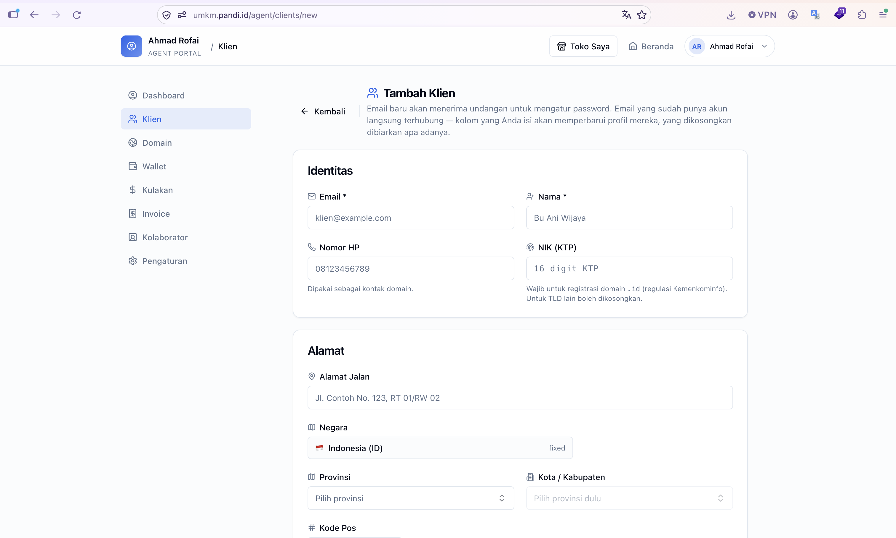
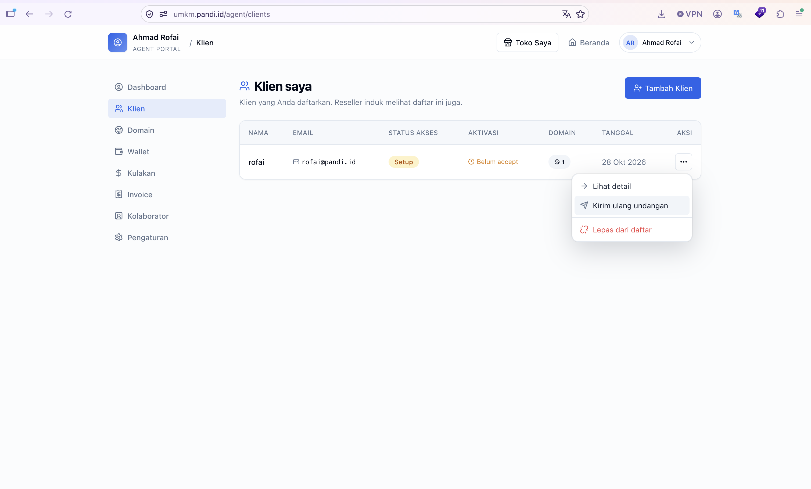
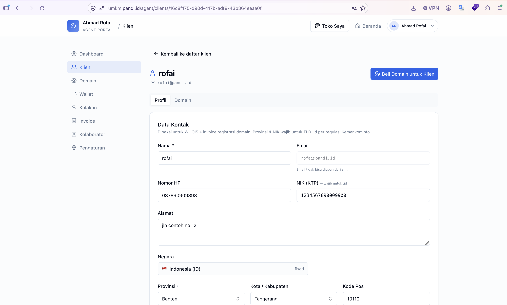

# Bab 2 — Panduan Agent

<!-- CATATAN EDITOR (hapus setelah beres):
     Screenshot alur klien di 2.4 sudah di-capture ulang 31 Okt 2026 dan sesuai
     UI terkini. Yang MASIH usang (19 Agustus 2026, sebelum UI dirombak):
       - agent-clients-list.png  → tidak punya kolom Domain / tombol aksi,
                                   bertentangan dengan tabel kolom di 2.3.
                                   Rujukannya sementara dilepas dari dokumen.
       - agent-dashboard.png     → perlu dicek ulang.
     Capture ulang: cd docs/user-guide/capture-screenshots && npm run capture:agent
     (butuh stack jalan + akun agent test berisi minimal 1 klien). -->

Agent adalah freelancer atau staff dari Reseller yang membantu klien setup
situs. Semua transaksi Agent otomatis di-debit dari **wallet Reseller induk**,
bukan wallet pribadi.

## 2.1 Cara Jadi Agent

Anda tidak bisa daftar Agent sendiri. Reseller induk akan **kirim invitation
email**:

1. Buka email dari Reseller — subject "Undangan Agent di [Nama Reseller]"
2. Klik link → halaman `Terima Undangan`
3. Set password Anda (email sudah pre-filled dari invitation)
4. Auto-login ke `/agent/dashboard`

## 2.2 Dashboard Agent


### Alur Kerja Agent

```
      ┌─────────┐
      │ Reseller│
      └────┬────┘
           │ invite
           ▼
      ┌─────────┐
      │  Anda   │  ◄── Login sebagai Agent
      │  Agent  │
      └────┬────┘
           │ manage
           ▼
      ┌─────────┐        ┌─────────┐
      │  Klien  │───────►│ Domain  │
      │(assigned│        │ Situs   │
      │ ke Anda)│        │(dibeli  │
      └─────────┘        │ atas    │
                         │ nama    │
                         │ klien)  │
                         └─────────┘
                              ▲
                              │ debit
                              │
                         ┌──────────┐
                         │ Wallet   │
                         │ Reseller │
                         │  (induk) │
                         └──────────┘
```

`/agent/dashboard` — overview aktivitas Anda:

- **Klien saya** — jumlah klien yang di-assign ke Anda (bisa < total klien Reseller)
- **Domain aktif** — total domain yang Anda register untuk klien
- **Pending jobs** — domain yang lagi proses (belum active)
- **Wallet activity** — riwayat transaksi Anda (di-debit dari wallet Reseller)

## 2.3 Kelola Klien

Menu **Klien** — `/agent/clients`:

### List Klien

Menampilkan semua klien yang Anda daftarkan sendiri, ditambah klien yang
di-assign ke Anda oleh Reseller induk. Perhatikan:

- Anda cuma lihat klien yang **assignment aktif** ke Anda
- Kalau Reseller cabut assignment, klien hilang dari list
- Reseller induk tetap bisa melihat semua klien yang Anda daftarkan

Tiap baris menampilkan:

| Kolom | Arti |
|-------|------|
| **Status Akses** | `Setup` = baru didaftarkan · `Aktif` = sudah siap dikelola |
| **Aktivasi** | `Belum accept` = undangan belum diterima, klien belum bisa login · `Email belum diverifikasi` = sudah bisa login, email saja yang belum dikonfirmasi · `Aktif` = beres |
| **Domain** | Jumlah domain aktif milik klien. Kosong (`—`) berarti belum punya |

## 2.4 Mendaftarkan Klien Baru

Anda **boleh mendaftarkan klien sendiri** — tidak perlu menunggu Reseller.

### Langkah

**1. Buka menu Klien, klik "Tambah Klien"**

Tombolnya ada di kanan atas. Kalau Anda belum punya klien sama sekali, tombol
yang sama juga muncul di tengah halaman.

**2. Isi formulir**



Hanya **Email** dan **Nama** yang wajib. Sisanya boleh menyusul.

| Bagian | Isi |
|--------|-----|
| **Email** | Alamat email klien. Ke sinilah undangan dikirim |
| **Nama** | Nama klien (muncul di email undangan) |
| **Nomor HP** | Dipakai sebagai kontak domain |
| **NIK (KTP)** | 16 digit. **Wajib untuk domain `.id`** per regulasi Kemenkominfo. Untuk TLD lain boleh kosong |
| **Alamat, Provinsi, Kota, Kode Pos** | Alamat klien untuk data WHOIS |

> **Provinsi dan Kota berupa pilihan, bukan ketikan.** Pilih Provinsi dulu,
> daftar Kota akan menyesuaikan. Ini mencegah salah ketik yang membuat
> pendaftaran domain ditolak registry.

> **Negara terkunci di Indonesia.** Platform ini melayani domain `.id` yang
> mensyaratkan kontak Indonesia.

**3. Klik "Tambah Klien"**

Yang terjadi berikutnya **tergantung apakah emailnya sudah terdaftar**:

#### Kalau email belum pernah terdaftar

- Akun klien dibuat
- Klien menerima **email undangan** berisi tautan untuk mengatur password
- Di daftar, Aktivasi klien tertulis **"Belum accept"** sampai mereka mengklik
  tautan itu

#### Kalau email sudah punya akun

Ini sering terjadi — misalnya klien pernah mendaftar sendiri sebelumnya.

- Akun lama **dipakai**, tidak dibuat akun baru
- **Password klien tidak berubah.** Mereka login seperti biasa, dan tidak ada
  undangan set-password yang dikirim
- Data yang Anda isi **menimpa** profil lama mereka; kolom yang Anda
  **kosongkan** tidak mengubah apa pun
- Klien menerima email pemberitahuan bahwa akun mereka kini Anda kelola
- Situs dan domain yang sudah mereka miliki **tetap utuh**

### Kirim Ulang Undangan

Kalau klien bilang emailnya tidak masuk:



1. Di daftar klien, klik tombol **⋯** di baris klien tersebut
2. Pilih **Kirim ulang undangan**

Undangan lama otomatis digantikan yang baru, berlaku 7 hari.

> Menu ini **hanya muncul** untuk klien berstatus "Belum accept". Klien yang
> sudah bisa login tidak punya undangan untuk diterima — kalau mereka lupa
> password, arahkan ke **Lupa password** di halaman login.

### Melepas Klien

1. Klik **⋯** → **Lepas dari daftar**
2. Konfirmasi di kotak dialog

Yang terjadi:

- Klien hilang dari daftar Anda, dan Anda berhenti bisa mengelola domain atau
  situs atas nama mereka
- **Akun, situs, dan domain milik klien tidak dihapus** — mereka tetap login
  seperti biasa
- Anda bisa menambahkannya lagi nanti dengan email yang sama

### Kalau Gagal

| Pesan | Artinya | Yang harus dilakukan |
|-------|---------|----------------------|
| `email sudah terdaftar sebagai reseller` (atau `agent`/`admin`) | Email itu dipakai akun dengan peran lain | Pakai email berbeda, atau minta orangnya memakai akun pribadi terpisah |
| `email sudah dikelola oleh manager lain` | Klien sudah jadi asuhan Agent/Reseller lain | Satu klien hanya boleh punya satu pengelola. Koordinasi dengan Reseller induk |
| `client ini sudah di-assign ke Anda` | Klien tersebut sudah ada di daftar Anda | Cek daftar, mungkin terhalang filter pencarian |

### Detail Klien



Klik nama klien (atau **⋯ → Lihat detail**) → halaman `/agent/clients/<id>`:

- **Info klien**: nama, email, telepon, alamat
- **Domain**: list domain yang klien punya (self + yang Anda belikan)
- **Situs**: list situs klien + link ke editor
- **Invoice**: riwayat transaksi klien
- **Aksi**:
  - **Beli Domain untuk klien** — trigger wizard OBO
  - **Edit profil klien** (nama, alamat, NIK)

### Edit Profil Klien

Karena Anda "care of" klien, Anda boleh update profil mereka untuk kelengkapan
WHOIS:

1. Klik **Edit Profil** di halaman detail klien
2. Update field yang kurang (mis. NIK untuk domain `.id`)
3. Simpan

Klien tetap bisa update sendiri kapan pun via login mereka.

## 2.5 Beli Domain untuk Klien (On-Behalf-Of)


Flow inti Agent: beli domain untuk klien pakai wallet Reseller induk.

### Langkah

1. Halaman detail klien → klik **Beli Domain**
2. Redirect ke wizard `/sites/new-with-domain?for_client=<uuid>`
3. Header wizard menampilkan **"Untuk klien: [nama klien]"** — konfirmasi Anda benar
4. Isi wizard seperti biasa:
   - Cari domain
   - Konfirmasi (pakai profil **klien**, bukan Anda)
   - Upload dokumen klien (kalau perlu)
   - **Metode bayar: pilih Wallet** — otomatis debit wallet Reseller induk
5. Klik **Beli & Bayar** → langsung `pending_provisioning` (instant, no gateway)
6. Setelah domain active → pilih template → situs dibuat, **owner = klien**

### Yang Otomatis Terjadi

- Domain di-register atas nama klien (WHOIS contact = klien)
- Situs otomatis attach ke domain
- Anda otomatis di-add sebagai **editor** di situs klien (bisa edit tapi tidak hapus)
- Transaksi dicatat di ledger wallet Reseller dengan metadata `agent_id = Anda`
- Reseller induk bisa lihat "berapa yang Anda pakai" di menu Wallet → Agents Breakdown

## 2.6 Metode Bayar Wallet

Agent **tidak punya wallet pribadi**. Setiap "bayar" via Wallet =
potong saldo wallet Reseller induk.

### Kalau Saldo Kurang

Kalau wizard tampilkan "Saldo kurang" saat pilih Wallet:
- Metode Wallet di-disable
- Alternatif: pilih gateway (Midtrans/Paylabs) — bayar sendiri, nanti coordination dengan Reseller
- Atau minta Reseller top-up dulu

### Lihat Aktivitas Anda

Menu **Wallet Activity** — list transaksi yang Anda trigger yang di-debit
dari wallet Reseller induk. Include:
- Domain register untuk klien X: `−Rp 250.000`
- Domain renew untuk klien Y: `−Rp 200.000`

Anda **tidak bisa** top-up wallet — itu tugas Reseller.

## 2.7 Manage Situs Klien

Setelah domain klien active + situs dibuat, Anda otomatis jadi editor:

1. Menu **Kolaborasi** — list semua situs klien yang Anda edit
2. Klik row → buka editor situs
3. Edit blocks, tema, konten seperti owner (kecuali tidak bisa hapus situs)

Klien juga bisa edit sendiri — kolaborasi real-time (dengan versi history).

## 2.8 Statistik Pribadi

Menu **Statistik** — `/agent/stats`:

- **Total klien** — yang di-assign ke Anda
- **Total domain register** — yang Anda trigger
- **Total revenue** — nilai transaksi yang Anda trigger (untuk komisi dari Reseller)
- **Breakdown per bulan** — chart aktivitas

## 2.9 Purchases History

Menu **Purchases** — `/agent/purchases`:

Semua register + renew yang Anda trigger, dengan info:
- Nama klien
- Nama domain
- Tahun
- Total
- Status (active / pending / failed)
- Timestamp

Filter:
- Status: all / active / pending / failed
- Kind: register / renew

Klik row → link ke halaman detail domain (kalau active) atau pending page
(kalau masih proses).

## 2.10 Team Domains

Menu **Domain Klien** — `/agent/domains`:

Berbeda dari Purchases (yang transaction log), ini list **per FQDN unik** —
1 baris per domain, current state:
- Nama domain
- Klien pemilik
- Status
- Expire date
- Situs terkait (kalau ada)

Cocok untuk monitor "domain klien mana yang mau expire" — filter
`expires_at ≤ 30 hari`.

## 2.11 Batasan Agent

Yang **BISA** Agent lakukan sendiri:

- ✅ Mendaftarkan klien baru (lihat 2.4)
- ✅ Kirim ulang undangan ke klien yang belum menerima
- ✅ Melepas klien dari daftar Anda
- ✅ Edit profil klien asuhan Anda
- ✅ Beli domain untuk klien memakai wallet Reseller induk

Yang **TIDAK BISA** (harus lewat Reseller induk):

- ❌ Assign klien ke agent lain
- ❌ Top-up wallet
- ❌ Set harga jual
- ❌ Menghapus akun klien — melepas klien hanya mencabut pengelolaan Anda,
  akunnya tetap ada
- ❌ Lihat aktivitas agent lain di tim Reseller

Kalau butuh salah satu di atas, koordinasi dengan Reseller induk.

## 2.12 Troubleshoot

**Klien saya hilang dari list**
- Reseller mungkin cabut assignment (revoke). Konfirmasi ke Reseller.
- Atau Anda sendiri sempat memilih **Lepas dari daftar**. Daftarkan ulang
  dengan email yang sama — akun dan situs klien tidak hilang.

**Klien bilang tidak menerima email undangan**
- Minta cek folder spam dulu
- Di daftar klien, klik **⋯** → **Kirim ulang undangan**
- Kalau menu itu tidak ada, berarti klien **sudah punya akses login** dan
  memang tidak butuh undangan. Arahkan ke **Lupa password** di halaman login.

**Saya sudah isi alamat dan NIK klien, tapi di halaman detail masih data lama**
- Ini terjadi kalau email klien sudah terdaftar sebelumnya dan Anda
  **mengosongkan** kolom tersebut saat menambahkan. Kolom kosong sengaja tidak
  menimpa data klien.
- Perbaiki lewat halaman detail klien → **Edit Profil**.

**Beli domain gagal — saldo kurang**
- Cek wallet Reseller di dashboard (menu Wallet — untuk Agent view balance saja, tidak bisa top-up)
- Kalau kurang, minta Reseller top-up dulu

**Klien butuh edit domain tapi saya tidak lihat opsi Edit Contact**
- Fitur ini di-lock ke owner domain (klien) via halaman `/settings/domains/<domain>`
- Klien harus login sendiri untuk update. Anda cuma bisa edit **situs**, tidak **domain settings**.

**Situs klien tidak bisa saya edit walau saya sudah beli untuk mereka**
- Cek `/collaborations` — semua situs di mana Anda editor
- Kalau tidak muncul, kemungkinan collaborator entry gagal di-create. Hubungi admin.
