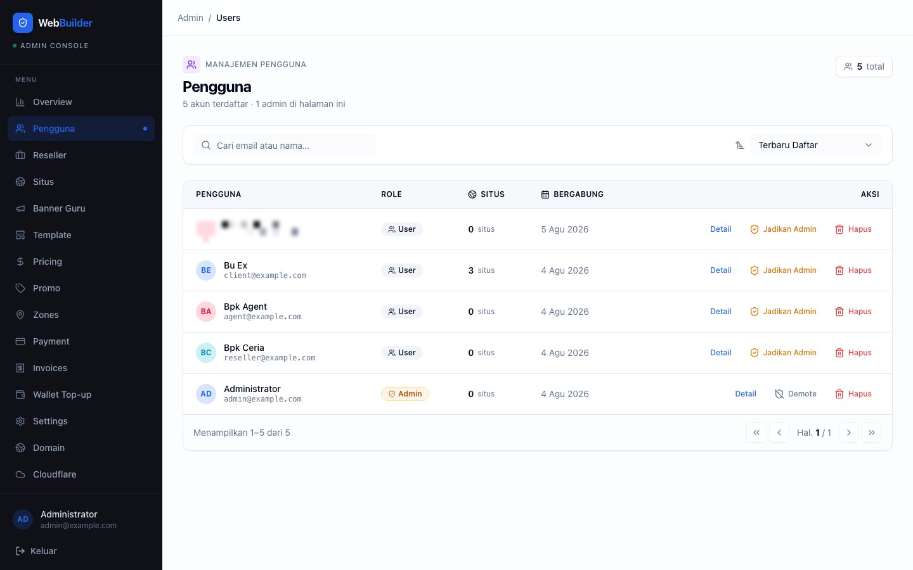

# Bab 4 — Panduan Admin

Admin adalah operator platform. Punya akses full ke semua data + config
sistem. Panduan ini asumsi Anda familiar dengan cara kerja SaaS multi-tenant
+ registrar domain.

## 4.1 Akses Admin Panel

Admin akun harus di-bootstrap via env var (`ADMIN_EMAIL` + `ADMIN_PASSWORD`
di `.env` API) saat pertama deploy. Setelah itu, admin bisa promote user lain
via panel.

Login → tombol **⚙ Admin Panel** muncul di header dashboard (kalau role
Anda `admin`). Klik → redirect ke `/admin`.

## 4.2 Overview Stats


### Struktur Sistem

```
                  ┌───────────────┐
                  │     ADMIN     │
                  │  (Anda, ops)  │
                  └───────┬───────┘
                          │
                          │ approve / manage
                          ▼
       ┌──────────────────┼──────────────────┐
       │                  │                  │
       ▼                  ▼                  ▼
  ┌─────────┐        ┌─────────┐        ┌─────────┐
  │Reseller │        │ Agent   │        │ Client  │
  │(mitra)  │───────►│ (staff  │───────►│ (end    │
  │         │        │  tim R) │        │  user)  │
  └────┬────┘        └─────────┘        └─────────┘
       │                                     ▲
       └─────────────────────────────────────┘
          Reseller/Agent bisa OBO (on-behalf-of)
```

`/admin` — dashboard stats:

- Total user (per role)
- Total situs (published / draft)
- Total domain aktif
- Total invoice (paid / unpaid)
- Revenue rolling 30 hari
- Chart aktivitas user + revenue

## 4.3 Kelola User



Menu **User** — `/admin/users`.

### List User

Kolom: email, nama, role, status verify, tanggal daftar, total situs.

Filter: role, status, search (email/nama).

### Detail User

Klik row → tab:
- **Profil** — full info
- **Situs** — list situs user
- **Invoice** — riwayat transaksi
- **Aksi**:
  - **Ganti Role** — promote/demote (client ↔ reseller ↔ agent ↔ admin)
  - **Reset Password** — kirim email reset
  - **Suspend** — user tidak bisa login (data tetap)
  - **Delete** — cascade hapus user + semua data (ireversibel!)

### Promote ke Admin

Hati-hati — admin punya akses full. Best practice:
1. Sebelum promote, konfirmasi via WA/email personal
2. Enable 2FA di akun mereka (belum ada, roadmap)
3. Log siapa promote siapa kapan (audit log auto-record)

## 4.4 Kelola Situs

Menu **Situs** — `/admin/sites`.

### List

Semua situs cross-user. Filter: owner, status (published/draft), search.

### Edit Kuota

Klik row → **Edit Quota**:
- **Max pages** — default 20
- **Max storage** — default 100 MB

Kalau ada user komplain quota habis, cek usage-nya dulu di `/sites/<id>/usage`
sebelum naikin (mungkin ada spam upload).

### Hapus Situs

**Delete** — cascade hapus situs + pages + assets + domain link.
Ireversibel. Konfirm ownership + reason sebelum delete.

## 4.5 Reseller Applications


Menu **Reseller** — `/admin/resellers`.

### List Pending Applications

Kolom: nama, email, reseller display name, tanggal apply, status.

Filter status: pending / approved / suspended.

### Detail Application

Klik row → info:
- Data pribadi + bisnis
- Alamat + phone
- Reason for apply (kalau ada field)

### Approve / Suspend

**Approve**:
1. Klik row → tombol **Approve**
2. Backend: role user diupgrade ke `reseller` + email notif dikirim
3. Status jadi `active`

**Suspend**:
1. Untuk reseller aktif — freeze akses tanpa hapus data
2. Isi reason (untuk audit + email ke reseller)
3. Klik **Suspend**
4. Reseller tidak bisa login, tapi klien + Agent + data tetap

**Unsuspend**: klik lagi → **Reactivate**.

### Tabs Detail Reseller

- **Klien** — semua klien yang mereka manage
- **Agent** — tim Agent
- **Domain** — semua domain yang mereka register (self + team)
- **Wallet** — saldo + ledger

## 4.6 Domain Observability

Menu **Domain** — `/admin/domain`.

Aggregate list per FQDN (cross-user). Cocok untuk monitor semua domain di
platform.

### List

Filter:
- Status: active / expired / suspended
- Expiring: dalam N hari
- Search: domain name / owner email

### Detail Domain

Klik row → `/admin/domain/<name>`:
- Info domain (bypass ownership check)
- WHOIS live
- Nameservers
- DNS records (via Cloudflare)
- **Cloudflare attach status** — kalau failed, tombol **Retry** available

### Cloudflare Retry

Kalau `cf_attach_status` = `failed`:
1. Klik tombol **Retry** di card CF status
2. Backend re-run tryAttachToCloudflare
3. Kalau sukses: badge jadi **Terhubung** (hijau)
4. Kalau tetap fail: cek error detail — biasanya:
   - Token CF invalid → update di `/admin/cloudflare`
   - Zone sudah exist di akun lain → hapus dulu di CF dashboard
   - Permission tidak cukup → cek token permission (butuh Account → Zone → Edit)

## 4.7 Registrar Purchases

Menu **Registrar** atau **Purchases** — `/admin/domain/purchases`.

Transaction log semua register + renew cross-user. Termasuk yang failed.

### Kegunaan

- Monitor rate transaksi
- Debug user yang stuck di pending
- Cari root cause failed jobs

### Retry Stuck Job

Klik row → kalau status `failed` / `pending_payment` / `pending_provisioning`:
- Tombol **Retry** di kolom Aksi
- Bypass ownership — admin bisa retry job siapa pun
- Idempotent — kalau job sudah active, no-op

## 4.8 Pricing Platform

Menu **Harga Platform** — `/admin/pricing/platform`.

Set harga baseline per TLD × periode. Ini yang di-refer Reseller saat set
markup mereka.

### Konsep

```
Untuk 1 TLD × N tahun:
  Retail Price     — yang client bayar (tanpa reseller)
  Wholesale Price  — cost basis (yang direseller bayar ke Anda)
  Cost Price       — biaya Anda ke registrar (untuk kalkulasi margin platform)
```

Contoh `.id` 1 tahun:
- Cost: Rp 150.000 (biaya ke PANDI)
- Wholesale: Rp 180.000 (dijual ke reseller — margin Anda Rp 30.000)
- Retail: Rp 250.000 (client self-purchase — margin Anda Rp 100.000)

### Set Harga

1. **+ TLD Baru** → pilih TLD dari list zone (dari `/admin/zones`)
2. Isi cost, wholesale, retail × register + renew
3. Simpan → langsung apply

Kalau TLD di zones tapi tidak ada di pricing, wizard beli domain tampilkan
"harga belum di-set" — client tidak bisa beli TLD itu.

## 4.9 Promo (Kupon Diskon)

Menu **Promo** — `/admin/promos`.

### Buat Promo Baru

1. **+ Promo** → isi:
   - **Code** — mis. `LAUNCH2026` (uppercase auto)
   - **Discount type** — percent atau fixed
   - **Discount value** — 20 (percent) atau 50000 (fixed IDR)
   - **Applies to** — register / renew / both
   - **TLD whitelist** — list TLD (kosong = semua)
   - **Min subtotal** — minimum belanja untuk aktif
   - **Max discount cap** — kalau percent, cap Rp
   - **Valid from / until** — tanggal aktif
   - **Max uses total** — total redemption
   - **Max uses per user** — cegah user pakai berkali
2. Simpan → langsung available di wizard

### Monitor Redemption

Detail promo → tab **Redemption**:
- List semua penggunaan dengan user, invoice, tanggal
- Unique per invoice (cegah dobel redeem)

### Deactivate

Bisa **Pause** promo tanpa hapus (redemption history tetap):
- Set status `paused` → tidak available di wizard walau valid window

## 4.10 Zone Catalog (TLD Config)

Menu **Zone** — `/admin/zones`.

Kontrol TLD apa yang platform Anda support.

### Field per Zone

- **TLD** — mis. `id`, `co.id`, `com`
- **Label** — display name (mis. `.id`, `.co.id`)
- **Active** — enable/disable tanpa hapus
- **Min years** — minimum tahun registrasi
- **Max years** — max tahun
- **Require document** — perlu KTP/NPWP upload (untuk `.id` family)
- **Auto approved** — bypass admin manual review (biasanya `.com`, `.net`)
- **NIK auto approved** — kalau NIK match validasi, auto approve

### Best Practice

- Jangan disable TLD yang masih ada user active — mereka tidak bisa renew!
- Kalau mau phase out, set price wholesale sangat tinggi (block ekonomi)
  daripada disable

## 4.11 System Settings

Menu **Settings** — `/admin/settings`.

Key-value store untuk config non-code:
- **PPN rate** — mis. `0.11` (11%)
- **Brand name** — untuk PDF invoice + email
- **Brand address** — di footer email + PDF
- **Support email** — kontak yang muncul di UI
- **Support phone**
- Dan config lain sesuai domain bisnis

Edit inline, save langsung apply.

## 4.12 Payment Methods

Menu **Payment Method** — `/admin/payment-methods`.

CRUD gateway pembayaran + config credentials.

### Tipe Gateway

- **gateway** — Midtrans, Paylabs (redirect ke halaman gateway)
- **manual** — Manual bank transfer (upload bukti, admin verify)
- **wallet** — Deposit wallet (potong saldo)

### Setup Gateway Baru

Contoh Midtrans:
1. **+ Payment Method**
2. Isi:
   - Code: `midtrans_snap`
   - Label: `Midtrans (Snap)`
   - Type: `gateway`
   - Enabled: `true`
   - Config JSON:
     ```json
     {
       "server_key": "SB-Mid-server-XXX",
       "client_key": "SB-Mid-client-XXX",
       "snap_url": "https://app.sandbox.midtrans.com/snap/v2/vtweb",
       "webhook_secret": "..."
     }
     ```
3. Simpan
4. Wizard beli domain langsung tampilkan opsi ini

### Setup Manual Bank

1. Code: `manual_bank`, type: `manual`
2. Config:
   ```json
   {
     "banks": [
       {"name":"BCA", "account_number":"1234567890", "account_holder":"PT Web Builder"}
     ],
     "instructions_md": "Setelah transfer, tunggu 1x24 jam."
   }
   ```
3. Simpan → wizard tampilkan instruksi transfer dengan bank list

### Disable

Uncheck **Enabled** → tidak muncul di wizard, tapi transaksi lama tetap
history. Cocok untuk sunset gateway.

## 4.13 Invoice Management


Menu **Invoice** — `/admin/invoices`.

### List All Invoices

Filter: status (draft/unpaid/paid/cancelled/expired), search.

### Mark Paid Manual

Untuk manual_bank flow — setelah verify transfer di bank statement:

1. Klik row invoice (status `unpaid`)
2. Klik **Tandai Paid**
3. Dialog: isi nomor referensi bank (opsional untuk audit)
4. Konfirm → invoice → paid + trigger `ExecuteAfterPayment` (register domain / credit wallet)

### Cancel Invoice

Untuk invoice unpaid yang expired atau salah:
1. Klik **Batalkan**
2. Isi reason (untuk audit)
3. Konfirm → status → `cancelled`, refund gateway (kalau applicable)

### Download PDF

Setiap invoice → tombol **PDF** — generate HTML print-friendly, browser bisa
Save As PDF.

*Note: PDF real belum di-render (masih HTML). Kalau butuh true PDF, install
wkhtmltopdf atau chromium-headless di server + swap renderer.*

## 4.14 Wallet Top-up Approval

Menu **Wallet Top-up** — `/admin/wallet/topups`.

### Queue Verification

Filter status `awaiting_verification` — top-up manual_bank yang user sudah
upload bukti.

### Approve Flow

1. Klik row → detail top-up
2. Klik **Lihat Bukti** → preview inline (image atau PDF)
3. Verify di mobile banking / rekening bank:
   - Nominal match?
   - Nama pengirim wajar?
   - Berita transfer include nomor invoice?
4. **Approve** — dialog konfirmasi + checkbox "Saya sudah verify dana masuk"
5. Konfirm → wallet user credit + ledger entry + email notif ke user

### Reject Flow

1. **Reject** button
2. Isi reason (mis. "Nominal tidak sesuai, kurang Rp 10.000")
3. Konfirm → status → `failed`, email ke user dengan reason
4. User bisa submit ulang top-up baru

### Manual Adjust

Tab **Wallet Adjust** — untuk case khusus (refund, koreksi bug):

1. Pilih user
2. Nominal (positif/negatif)
3. Reason (wajib untuk audit)
4. Submit → immediate credit/debit dengan ledger entry

## 4.15 Cloudflare Configs


Menu **Cloudflare** — `/admin/cloudflare`.

Multi-account support — bisa punya beberapa CF config, salah satu di-tag `default`.

### Add Config

1. **+ Cloudflare Config**
2. Isi:
   - **Nama** — mis. `webbuilder-prod`
   - **Account ID** — dari CF dashboard
   - **API Token** — dengan permission:
     - Account → Zone → Edit
     - Zone → Zone → Edit
     - Zone → DNS → Edit
3. Klik **Verify** — test token via `/user/tokens/verify` atau `/accounts/{id}/tokens/verify`
4. Kalau valid, **Simpan**

### Set Default

Toggle bintang di row config → jadi default untuk auto-attach domain baru.

### Rotate Token

1. Buat token baru di CF dashboard (permission sama)
2. Klik row → **Edit** → paste token baru
3. Verify → save
4. Token lama bisa di-delete di CF dashboard

## 4.16 Templates

Menu **Template** — `/admin/templates`.

### List

Semua template (built-in seed + custom yang admin buat).

Filter: status (draft/published/archived), category.

### Create Custom Template

1. **+ Template Baru**
2. Isi metadata: slug, name, category, variant, description
3. Design block tree (edit di editor site → save-as-template — belum ada, roadmap)
4. Publish → available di wizard untuk client

### Publish / Archive

- **Publish** — public visible di wizard
- **Archive** — hide dari wizard (transaksi historis pakai template ini tetap OK)

### Duplicate

Kalau mau bikin variant dari template existing → **Duplicate** → rename +
modify.

## 4.17 Audit Log

Menu **Audit Log** — `/admin/audit-log`.

Semua action penting yang admin lakukan:
- Reseller approve/suspend
- Invoice mark-paid
- User promote/demote
- Delete site/user
- Promo apply
- Domain retry

Filter: event, actor (siapa yang do), target (siapa yang kena), tanggal.

Untuk compliance + forensic kalau ada dispute.

## 4.18 Email Log

Menu **Email Log** — `/admin/email-log`.

List semua email yang dikirim sistem (verification, reset password,
invitation, domain expiry, top-up approved, dsb.).

Filter: kind, to (email penerima).

Kalau user komplain "tidak terima email X":
1. Cek email log — status `sent` / `failed`?
2. Kalau `sent` tapi user tidak dapat: cek Spam folder mereka
3. Kalau `failed`: cek SMTP config di `.env` API

## 4.19 Metrics + Observability

`/metrics` — Prometheus scrape endpoint (tidak di UI admin, akses via curl atau Grafana).

Counter penting:
- `domain_purchase_created_total{result,gateway}` — success rate purchase
- `payment_webhooks_total{code,result}` — webhook health per gateway
- `cloudflare_attach_total{result}` — CF attach success rate
- `domain_expiry_notices_total{result}` — email reminder health

Setup Grafana dashboard untuk trend visualization.

## 4.20 Best Practice Admin

**1. Backup DB rutin**

`registered_domains`, `sites`, `invoices` = data authoritative. Backup harian
minimum, PITR (Point-in-Time Recovery) kalau volume tinggi.

**2. Monitor 502 di api-registry**

Kalau EPP session drop, api-registry sering 502. Cek log
`pm2 logs api-registry | grep 502`. Fix: set `EPP_PER_COMMAND_SESSION=true`
di `.env` api-registry (trade latency vs stability).

**3. Verify Cloudflare token expire policy**

Kalau token TTL bukan `Forever`, set reminder untuk rotate sebelum expire.
Kalau expire, auto-attach domain baru bakal fail.

**4. Update system_settings PPN rate rutin**

Kalau ada perubahan regulasi PPN, update via `/admin/settings/ppn_rate`.
Invoice yang sudah issued tetap pakai rate saat itu, invoice baru pakai rate baru.

**5. Cek expired domain queue**

Menu Domain filter `expires_at ≤ 7 hari` — kirim reminder manual ke user
kalau email otomatis tidak jalan.

## 4.21 Troubleshoot

**API service crash / restart-loop**
- Cek log: `pm2 logs api --lines 200`
- Kemungkinan: DB migration failed, credential invalid, config validation error
- Fix root cause di `.env` atau code, restart

**Semua request 502 dari Caddy**
- Cek API service jalan: `pm2 status`
- Cek port match: `.env` `HTTP_ADDR` vs Caddyfile `reverse_proxy`
- Cek firewall antara Caddy ↔ API (kalau beda server)

**Domain aktif tapi tidak resolve di browser**
- Cek Cloudflare attach status di `/admin/domain/<name>`
- Cek DNS record A `@` point ke platform IP
- Test propagation: `dig <domain> +short @1.1.1.1`

**Invoice paid tapi domain tidak provision**
- Cek `pm2 logs api | grep ExecuteAfterPayment`
- Manual retry: `/admin/domain/purchases` → cari job → tombol **Retry**

**User tidak dapat email verifikasi**
- Cek `/admin/email-log` filter user tersebut
- Cek SMTP config di `.env` API — mungkin kredensial expired atau rate-limited

**Reseller apply spam / abuse**
- Reject applications yang tidak masuk akal
- Kalau signup rate abnormal, tambah rate limit di `/api/v1/auth/reseller/apply`
  (config di code, butuh redeploy)
